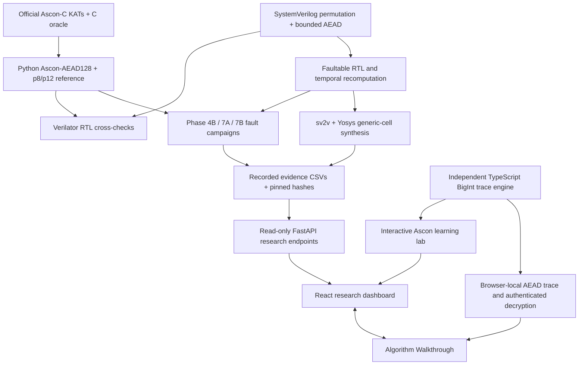

# FaultScope-Ascon

**A pre-silicon hardware-security workbench for NIST Ascon-AEAD128.**

FaultScope-Ascon connects a verified cryptographic reference, synthesizable SystemVerilog, deterministic fault-injection experiments, temporal recomputation, hardware-cost analysis, and a two-page interactive research and algorithm website. Its main question is:

> **When does re-executing a cryptographic operation detect faults, and what happens when the replay, checkpoint, or comparator cannot be trusted?**

The project is a **research and teaching prototype**, not a production cryptographic library or a demonstrated physical fault attack.

**Repository:** [pm2m1/faultscope-ascon](https://github.com/pm2m1/faultscope-ascon) | **Stack:** SystemVerilog, Python, Verilator, Yosys, Vivado, React, TypeScript, FastAPI | **Verified GitHub CI baseline:** 514 passed, 6 skipped (commit `8b46a3f`, October 2026).

## At a glance

| Area | What is implemented |
|---|---|
| Cryptographic reference | NIST Ascon-AEAD128 encryption/decryption and p[8]/p[12] permutation; verified using official Ascon-C known-answer tests (KATs) |
| Hardware | Synthesizable permutation and bounded **encryption + tag generation** datapath; associated data and plaintext each limited to 0–16 bytes |
| Defense | Temporal recomputation, mismatch alarm, and fail-closed output gating for the tested fault model |
| Experiments | First-pass transient faults; adversarial first/replay, shared-checkpoint, and simulated comparator-suppression hooks |
| Evaluation | Verilator testbenches, Python reference checks, simulation-cycle measurements, generic Yosys cell counts |
| Research Dashboard | Original dark navy/cyan interface, project architecture, hash-verified evidence, filters, charts, Simple/Technical views and permutation Learning Lab |
| Algorithm Walkthrough | Browser-local Ascon-AEAD128 encryption/authenticated decryption, eight-step state trace, round/layer and byte-XOR exploration, playback and tamper rejection |

**Measured findings** — 93/93 applied single first-pass faults were detected with a clean replay; adversarial test fixtures also exposed incorrect releases under correlated faults or compromised comparison assumptions. See [Results](#results-and-how-to-interpret-them) for exact denominators and limitations.

## Start here: run the project

The repository is public and can be cloned without repository-specific access.

### Requirements

- The reference/RTL baseline is tested on macOS and Ubuntu CI. The website, reference/API subset and Edge browser tests are also validated on Windows; this does not qualify native Windows RTL/formal toolchains.
- Python **3.12**, [`uv`](https://docs.astral.sh/uv/), Git, and C/C++ development tools (Apple Command Line Tools on macOS).
- **Verilator**, **Yosys**, **sv2v**, and **CMake** for hardware experiments and tests.
- Node.js **22+** and npm for the frontend and TypeScript cross-checks.

For example, on macOS with [Homebrew](https://brew.sh/):

```bash
brew install uv node verilator yosys sv2v cmake
xcode-select --install  # Only if Apple's Command Line Tools are not installed
```

The recorded environment used Python 3.12.14, Verilator 5.052, Yosys 0.69+post, sv2v 0.0.13, and Node 24.20.0. Exact synthesis results can depend on tool versions.

### 1. Clone and restore the pinned upstream reference

```bash
git clone https://github.com/pm2m1/faultscope-ascon.git
cd faultscope-ascon

mkdir -p references
git clone https://github.com/ascon/ascon-c.git references/ascon-c
git -C references/ascon-c checkout --detach "$(cat docs/ascon_reference_commit.txt)"

# Must complete successfully:
test "$(git -C references/ascon-c rev-parse HEAD)" = "$(cat docs/ascon_reference_commit.txt)"
```

The upstream Ascon-C reference is pinned to commit `446347f21b209f3921c65ece70027c366cbe1693` and deliberately excluded from this repository. Tests require its reference C implementation and the official `LWC_AEAD_KAT_128_128.txt` file.

### 2. Install dependencies and verify the baseline

Run from the repository root:

```bash
uv sync --locked --group dev
cd frontend && npm ci && cd ..

uv run python -m pytest tests/ -q
cd frontend && npm run build && cd ..
```

**Verified at commit `8b46a3f`:** GitHub Actions reported 514 passed and 6 skipped in the Python/RTL suite, with successful frontend build, Yosys synthesis and formal verification jobs. Results depend on the documented environment and tool versions.

### 3. Launch the two-page website

In terminal 1 (repository root):

```bash
uv run uvicorn backend.api:app --reload --host 127.0.0.1 --port 8000
```

In terminal 2:

```bash
cd frontend
npm run dev
```

Visit **http://127.0.0.1:5173**. Vite proxies `/api` to the local FastAPI process at `127.0.0.1:8000`.

> **Quick demo:** Open the overview, compare Phase 4B and the adversarial phases, filter an incorrect-release case in **Adversarial research**, then open the **Ascon learning lab** to step through p[12] and contrast a first-only fault against identical faults in both executions.

### Pages and the HELLO demonstration

- Research Dashboard (default): **http://127.0.0.1:5173/#/**
- Algorithm Walkthrough: **http://127.0.0.1:5173/#/walkthrough**
- Recorded research results: **http://127.0.0.1:5173/#/results**

The dashboard retains its dark navy/cyan presentation, sidebar, evidence charts, filters, pagination and original Learning Lab. It adds a project explanation, architecture, actual permutation-level protection demonstration and optional Technical View. Browser back/forward preserves dashboard filter state.

In Algorithm Walkthrough, enter **HELLO**, associated data **Course: CNS**, synthetic key `000102030405060708090a0b0c0d0e0f` and nonce `101112131415161718191a1b1c1d1e1f` in the advanced input section. Click **Encrypt My Message**. The computed ciphertext is `a0b29b6679`, with tag `38a5911ee12bb09077fdc926a45cae30`. Explore the eight steps, p[8]/p[12] rounds and byte XOR, then **Verify & decrypt**. HELLO is released after authentication succeeds; **Tamper With Message** and **Tamper With Tag** cause rejection.

The fixed values are **demo-only**: a nonce must be unique for each encryption under the same real key. The form accepts at most 16 UTF-8 bytes each of plaintext and AD. Editing inputs stops playback and clears the old trace. Keys/plaintext remain browser-local and are not stored or sent to the evidence API. This educational implementation is not a production cryptographic library.

### Windows startup

From an existing repository checkout, with Python 3.12, uv and Node 22.19+ installed:

```powershell
# Repository root; one-time dependency setup
uv sync --locked --group dev
npm.cmd --prefix frontend ci

# Terminal 1, from the repository root
uv run uvicorn backend.api:app --host 127.0.0.1 --port 8000
```

```powershell
# Terminal 2, from the repository root
npm.cmd --prefix frontend run dev
```

### Website validation

Restore the pinned Ascon-C checkout above before running reference/vector tests. On Windows, its exact checkout can be selected with `git -C references/ascon-c checkout --detach (Get-Content docs/ascon_reference_commit.txt).Trim()` after cloning that external repository.

```powershell
# Repository root
uv run faultscope-ascon verify-evidence
uv run python -m pytest tests/test_algorithm_walkthrough.py tests/test_aead.py tests/test_phase8b_lab.py tests/test_dashboard_api.py tests/test_phase8a_research_api.py tests/test_phase5_analysis.py -q
npm.cmd --prefix frontend run build
$env:FAULTSCOPE_TEST_PYTHON = (uv run python -c "import sys; print(sys.executable)").Trim()
npm.cmd --prefix frontend run test:ui
```

Windows browser tests use installed Microsoft Edge. On Linux, install Playwright Chromium with `cd frontend` then `npx playwright install --with-deps chromium` before running `npm run test:ui`. Each run writes logs/screenshots to a new ignored `build/reproduction/website_ui/` directory; `FAULTSCOPE_UI_OUTPUT` can select an explicit output directory. The separate website workflow runs the browser interactions on GitHub without weakening the existing reference/RTL and formal workflows.

The reference tests compare all 1,089 pinned official vectors and every round layer for 0/1/15/16-byte boundaries. Browser tests cover navigation, API-backed findings, filters/pagination, the Learning Lab, HELLO, decryption/tamper rejection, playback, all teaching fault scenarios, dark styling, keyboard operation and responsive layouts. See [walkthrough details](docs/algorithm_walkthrough.md) and [project showcase](docs/project_showcase.md).

## Architecture



The browser's educational trace engine performs deterministic state calculations, but **does not alter or regenerate the committed experimental evidence**. The research API reads fixed, hash-checked local CSV files; it does not expose shell execution, experiment triggering, or arbitrary file uploads.

## Cryptographic and hardware scope

NIST's [SP 800-232](https://csrc.nist.gov/pubs/sp/800/232/final) standardizes the Ascon-based lightweight cryptography algorithms. This project models the Ascon-AEAD128 workflow using a **320-bit state** (`x0`–`x4`, five 64-bit words); permutation rounds apply a round constant, nonlinear substitution, and linear diffusion.

The Python reference provides **encryption and authenticated decryption** for verification. The synthesizable AEAD datapath implements **bounded encryption and authentication-tag generation only**, not RTL authenticated decryption. Plaintext and associated-data lengths are independently bounded at **0–16 bytes**; the engine processes one transaction at a time.

The project is not intended for production keys. In any AEAD use, a nonce must not be reused with the same key.

## Results and how to interpret them

### Fault-campaign outcomes

| Campaign | Scope and assumptions | Cases | Observed outcome |
|---|---|---:|---|
| **4B — clean replay** | Single transient pre-round state-bit fault in **first execution only**; clean replay, checkpoint, comparator | **424** | **93/93** applied faults detected; **0/331** no-injection cases raised alarms |
| **7A — adversarial permutation** | Independently controlled first/replay faults, checkpoint corruption and simulated alarm suppression | **240** | **120** raw mismatches, **80** alarms, **60** silent incorrect permutation-state releases |
| **7B — adversarial bounded AEAD** | Similar adversarial hooks at the encryption/tag datapath; input lengths limited to 0–16 bytes | **600** | **204** raw mismatches, **136** alarms, **102** incorrect ciphertext/tag releases |

**Do not combine these outcomes into an overall fault-detection percentage.** Their test populations and fault assumptions differ, and the mismatch, alarm, and incorrect-release counts can overlap. The 7A/7B scenarios were **deliberately constructed**, not sampled from a physical attack distribution. An *incorrect release* means the output is marked valid but differs from the fault-free result; it **does not** demonstrate successful recipient-side tag-verification bypass, forged-message acceptance, key recovery, or physical attack feasibility.

### Implementation cost

Using the same `sv2v` + Yosys **`synth -flatten -noabc`** generic synthesis flow:

| Architecture | Generic Yosys cells | Sequential output bits |
|---|---:|---:|
| Baseline (no fault instrumentation) | **8,277** | **1,625** |
| Fault-instrumented (no temporal defense) | **9,865** | **1,659** |
| Temporal-recomputation protected | **12,863** | **2,645** |

The protected design uses **55.41% more generic cells than the uninstrumented baseline**, or **30.39% more than the fault-instrumented variant**. The latter is a more relevant (though still approximate) indication of the incremental cost of protection. The Phase 4B campaigns measured **47.17 mean baseline cycles** and **95.64 protected cycles**, a **102.77% increase in mean cycle count**.

**Interpretation:** generic synthesis cells are **not** FPGA LUT counts, silicon area, timing, power, or energy. Cycle counts by themselves do not establish throughput at a particular clock frequency. For methodology and provenance, see [`reports/phase5/REPORT.md`](reports/phase5/REPORT.md) and [`docs/phase5_hardware_cost_evaluation.md`](docs/phase5_hardware_cost_evaluation.md).

## Inspect and reproduce the evidence

The committed campaign files are preserved byte-for-byte using `.gitattributes`; the backend rejects a Phase 7 CSV if its SHA-256 differs from its pinned snapshot. The Phase 5 manifest also pins the Phase 4B campaign and the RTL inputs used for synthesis.

**Verify existing evidence without modifying it:**

```bash
uv run python - <<'PY'
import hashlib, json
from pathlib import Path
from backend.research import CAMPAIGNS

manifest = json.loads(Path('reports/phase5/manifest.json').read_text())
expected = {
    'reports/phase4b_temporal.csv': manifest['campaign_sha256'],
    **{c['path']: c['sha256'] for c in CAMPAIGNS.values()},
}
for name, digest in expected.items():
    actual = hashlib.sha256(Path(name).read_bytes()).hexdigest()
    print(f"{'PASS' if actual == digest else 'FAIL'}  {name}  {actual}")
    if actual != digest:
        raise SystemExit(1)
PY
```

**To re-run experiments, write to ignored `build/` instead of overwriting committed evidence:**

```bash
mkdir -p build/reproduction
uv run python -m experiments.run_phase4b --out build/reproduction/phase4b_temporal.csv
uv run python -m experiments.run_phase7 --out build/reproduction/phase7_adversarial.csv
uv run python -m experiments.run_phase7b --out build/reproduction/phase7b_aead.csv

# Optional and more resource intensive; output includes synthesis netlists and logs:
uv run python -m experiments.run_phase5 \
  --campaign reports/phase4b_temporal.csv \
  --out-dir build/reproduction/phase5
```

Compare old/new hashes and analyze any mismatch; **do not silently repin committed evidence**. Report generation timestamps, compiler versions and absolute paths may vary. The historical commit in `reports/phase5/manifest.json` records provenance and is **not required to match the current Git HEAD**.

## Source map

| Location | Responsibility |
|---|---|
| [`reference/`](reference) | NIST Ascon Python oracle and modeled adversarial cases |
| [`rtl/`](rtl) | Synthesizable permutation and bounded AEAD, protected variants, research-only hooks |
| [`tb/`](tb) | Verilator testbenches and independent C permutation oracle |
| [`experiments/`](experiments) | Deterministic campaign runners and synthesis report generator |
| [`tests/`](tests) | Official KATs, RTL/software comparisons, API-integrity tests, and TS/Python consistency |
| [`reports/`](reports) | Frozen experimental data, manifests, and summarized synthesis measurements |
| [`backend/`](backend) | Read-only evidence-serving FastAPI endpoints |
| [`frontend/`](frontend) | Dark two-page React/Vite website: research dashboard, original Learning Lab and real AEAD walkthrough |
| [`docs/`](docs) | Phase-by-phase technical and research methodology notes |
| [`src/faultscope_ascon/`](src/faultscope_ascon) | Evidence-verification and local API CLI; frontend is launched separately |

Available local API routes include `GET /api/health`, `/api/summary`, `/api/cases`, `/api/research/summary`, and `/api/research/cases`.

## Threat model and limitations

- **Pre-silicon only.** Faults are injected through explicit digital RTL hooks, not laser, EM, power, voltage, clock, or other physical apparatus.
- **Limited clean-replay result.** Phase 4B's 93/93 result presumes a trustworthy replay, checkpoint and comparator; its no-alarm cases do not prove a zero false-alarm probability.
- **Adversarial fault hooks are test instrumentation.** Dual-execution correlation, shared-checkpoint corruption, and comparator suppression intentionally violate the original trust assumptions. They are not a secure production implementation.
- **Encrypt/tag RTL only.** No RTL authenticated decryption, recipient forgery acceptance, key extraction, or bypass of a real verifier has been established.
- **Implementation evidence has distinct scopes.** Phase 5 reports technology-independent Yosys cell counts. Later phases document FPGA mapping and Vivado routed implementation under stated timing assumptions. Physical board execution, complete external I/O timing qualification, power measurement and physical fault resistance remain unverified.
- **No production-security claim.** Results are informative within their specified models; the system has not undergone a third-party security audit.

## Project status and next steps

**Verified implementation:** Official cryptographic vectors, Python/RTL comparisons, fault campaigns, evidence-integrity checks, dashboard, TypeScript trace cross-checks, and local frontend build. GitHub Actions independently verified the committed implementation at `8b46a3f`.

**Remaining qualifications:** Retain the qualified Phase 24 evidence boundary. Its saved post-merge audit and subsequent read-only review checked the nine archives, five reproduced Phase 23 reports and accepted checkpoint; this is not physical signoff. The historical quiet CI log records six skips without their individual node IDs. Qualify external I/O timing, reset and CDC assumptions, and validate operation on a physical board only if hardware deployment is pursued. Additional fault models and demonstration media are optional future work.

The installed CLI supports `uv run faultscope-ascon verify-evidence` and `uv run faultscope-ascon serve`. The React interface is started separately with `cd frontend` followed by `npm run dev`.

## References, provenance and reuse

- [NIST SP 800-232 — Ascon-based Lightweight Cryptography Standards](https://csrc.nist.gov/pubs/sp/800/232/final)
- [Ascon-C: official upstream implementation](https://github.com/ascon/ascon-c) — exact revision pinned in [`docs/ascon_reference_commit.txt`](docs/ascon_reference_commit.txt)
- [Phase 4B — temporal recomputation](docs/phase4b_temporal_recomputation.md)
- [Phase 5 — synthesis and latency methodology](docs/phase5_hardware_cost_evaluation.md)
- [Phase 7A — adversarial permutation experiments](docs/phase7a_adversarial_temporal.md)
- [Phase 7B — adversarial bounded AEAD experiments](docs/phase7b_bounded_aead_adversarial.md)
- [Phase 8A — evidence dashboard](docs/phase8a_unified_dashboard.md)
- [Phase 8B — interactive learning lab](docs/phase8b_ascon_learning_lab.md)

**Maintainer:** [Parth Mishra (`pm2m1`)](https://github.com/pm2m1).

**Attribution and AI assistance:** The upstream Ascon standard and Ascon-C implementation are third-party work. AI tools assisted parts of the project planning, code/documentation drafting, and review; experimental outputs and security claims should be attributed to their test procedures and independently verified before external publication.

**Licensing:** The repository is public, but no project-level `LICENSE` file is committed. Public visibility does not automatically grant open-source reuse rights. Review and add an appropriate license if broader reuse is intended; upstream components have separate terms.
