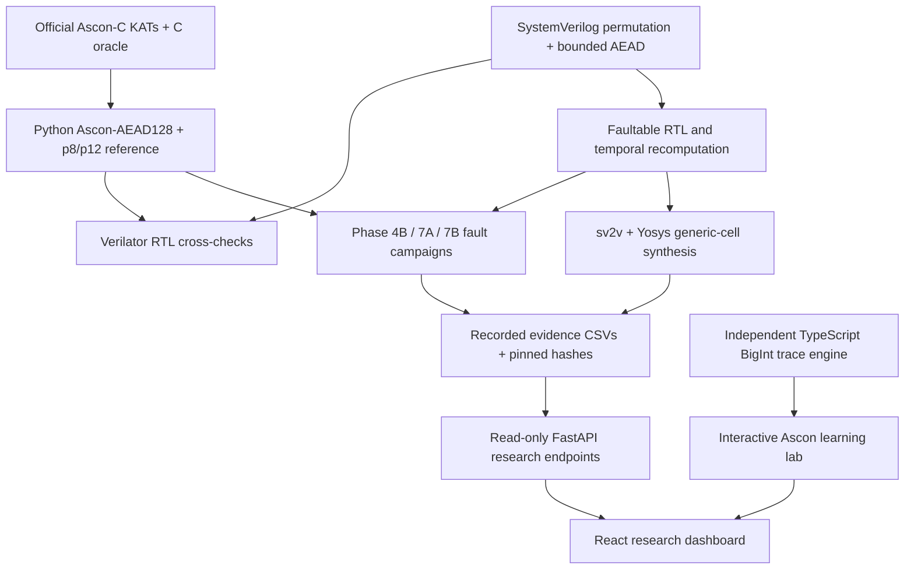

# FaultScope-Ascon

**A pre-silicon hardware-security workbench for NIST Ascon-AEAD128.**

FaultScope-Ascon connects a verified cryptographic reference, synthesizable SystemVerilog, deterministic fault-injection experiments, temporal recomputation, hardware-cost analysis, and an interactive research dashboard. Its main question is:

> **When does re-executing a cryptographic operation detect faults, and what happens when the replay, checkpoint, or comparator cannot be trusted?**

The project is a **research and teaching prototype**, not a production cryptographic library or a demonstrated physical fault attack.

**Repository:** [pm2m1/faultscope-ascon](https://github.com/pm2m1/faultscope-ascon) · **Language/stack:** SystemVerilog, Python, Verilator, Yosys, React, TypeScript, FastAPI · **Verified development baseline:** 48 passing pytest cases and successful Vite production build (October 2026, macOS).

## At a glance

| Area | What is implemented |
|---|---|
| Cryptographic reference | NIST Ascon-AEAD128 encryption/decryption and p[8]/p[12] permutation; verified using official Ascon-C known-answer tests (KATs) |
| Hardware | Synthesizable permutation and bounded **encryption + tag generation** datapath; associated data and plaintext each limited to 0–16 bytes |
| Defense | Temporal recomputation, mismatch alarm, and fail-closed output gating for the tested fault model |
| Experiments | First-pass transient faults; adversarial first/replay, shared-checkpoint, and simulated comparator-suppression hooks |
| Evaluation | Verilator testbenches, Python reference checks, simulation-cycle measurements, generic Yosys cell counts |
| Interactive UI | Hash-verified research dashboard, filterable campaign evidence, animated 320-bit Ascon permutation and fault/replay lab |

**Measured findings** — 93/93 applied single first-pass faults were detected with a clean replay; adversarial test fixtures also exposed incorrect releases under correlated faults or compromised comparison assumptions. See [Results](#results-and-how-to-interpret-them) for exact denominators and limitations.

## Start here: run the project

The repository is currently **private**. You need access to clone it.

### Requirements

- macOS / Apple Silicon is the **tested environment**; other platforms have not been independently qualified.
- Python **3.12**, [`uv`](https://docs.astral.sh/uv/), Git, and C/C++ development tools (Apple Command Line Tools on macOS).
- **Verilator**, **Yosys**, **sv2v**, and **CMake** for hardware experiments and tests.
- Node.js **22+** and npm for the frontend and TypeScript cross-checks.

For example, on macOS with [Homebrew](https://brew.sh/):

```bash
brew install uv node verilator yosys sv2v cmake
xcode-select --install  # Only if Apple's Command Line Tools are not installed
```

The recorded environment used Python 3.12.14, Verilator 5.052, Yosys 0.69+post, sv2v 0.0.13, and Node 24.20.0. Exact synthesis results can depend on tool versions.

### 1. Clone and restore the pinned upstream reference

```bash
git clone https://github.com/pm2m1/faultscope-ascon.git
cd faultscope-ascon

mkdir -p references
git clone https://github.com/ascon/ascon-c.git references/ascon-c
git -C references/ascon-c checkout --detach "$(cat docs/ascon_reference_commit.txt)"

# Must complete successfully:
test "$(git -C references/ascon-c rev-parse HEAD)" = "$(cat docs/ascon_reference_commit.txt)"
```

The upstream Ascon-C reference is pinned to commit `446347f21b209f3921c65ece70027c366cbe1693` and deliberately excluded from this repository. Tests require its reference C implementation and the official `LWC_AEAD_KAT_128_128.txt` file.

### 2. Install dependencies and verify the baseline

Run from the repository root:

```bash
uv sync --locked --group dev
cd frontend && npm ci && cd ..

uv run python -m pytest tests/ -q
cd frontend && npm run build && cd ..
```

**Expected at the documented development revision:** `48 passed` with one non-fatal Starlette/httpx deprecation warning, and a successful TypeScript/Vite build. This is an observed local baseline, **not** a GitHub Actions CI badge or a guarantee on untested operating systems.

### 3. Launch the dashboard

In terminal 1 (repository root):

```bash
uv run uvicorn backend.api:app --reload --host 127.0.0.1 --port 8000
```

In terminal 2:

```bash
cd frontend
npm run dev
```

Visit **http://127.0.0.1:5173**. Vite proxies `/api` to the local FastAPI process at `127.0.0.1:8000`.

> **Quick demo:** Open the overview, compare Phase 4B and the adversarial phases, filter an incorrect-release case in **Adversarial research**, then open the **Ascon learning lab** to step through p[12] and contrast a first-only fault against identical faults in both executions.

## Architecture



The browser's educational trace engine performs deterministic state calculations, but **does not alter or regenerate the committed experimental evidence**. The research API reads fixed, hash-checked local CSV files; it does not expose shell execution, experiment triggering, or arbitrary file uploads.

## Cryptographic and hardware scope

NIST's [SP 800-232](https://csrc.nist.gov/pubs/sp/800/232/final) standardizes the Ascon-based lightweight cryptography algorithms. This project models the Ascon-AEAD128 workflow using a **320-bit state** (`x0`–`x4`, five 64-bit words); permutation rounds apply a round constant, nonlinear substitution, and linear diffusion.

The Python reference provides **encryption and authenticated decryption** for verification. The synthesizable AEAD datapath implements **bounded encryption and authentication-tag generation only**, not RTL authenticated decryption. Plaintext and associated-data lengths are independently bounded at **0–16 bytes**; the engine processes one transaction at a time.

The project is not intended for production keys. In any AEAD use, a nonce must not be reused with the same key.

## Results and how to interpret them

### Fault-campaign outcomes

| Campaign | Scope and assumptions | Cases | Observed outcome |
|---|---|---:|---|
| **4B — clean replay** | Single transient pre-round state-bit fault in **first execution only**; clean replay, checkpoint, comparator | **424** | **93/93** applied faults detected; **0/331** no-injection cases raised alarms |
| **7A — adversarial permutation** | Independently controlled first/replay faults, checkpoint corruption and simulated alarm suppression | **240** | **120** raw mismatches, **80** alarms, **60** silent incorrect permutation-state releases |
| **7B — adversarial bounded AEAD** | Similar adversarial hooks at the encryption/tag datapath; input lengths limited to 0–16 bytes | **600** | **204** raw mismatches, **136** alarms, **102** incorrect ciphertext/tag releases |

**Do not combine these outcomes into an overall fault-detection percentage.** Their test populations and fault assumptions differ, and the mismatch, alarm, and incorrect-release counts can overlap. The 7A/7B scenarios were **deliberately constructed**, not sampled from a physical attack distribution. An *incorrect release* means the output is marked valid but differs from the fault-free result; it **does not** demonstrate successful recipient-side tag-verification bypass, forged-message acceptance, key recovery, or physical attack feasibility.

### Implementation cost

Using the same `sv2v` + Yosys **`synth -flatten -noabc`** generic synthesis flow:

| Architecture | Generic Yosys cells | Sequential output bits |
|---|---:|---:|
| Baseline (no fault instrumentation) | **8,277** | **1,625** |
| Fault-instrumented (no temporal defense) | **9,865** | **1,659** |
| Temporal-recomputation protected | **12,863** | **2,645** |

The protected design uses **55.41% more generic cells than the uninstrumented baseline**, or **30.39% more than the fault-instrumented variant**. The latter is a more relevant (though still approximate) indication of the incremental cost of protection. The Phase 4B campaigns measured **47.17 mean baseline cycles** and **95.64 protected cycles**, a **102.77% increase in mean cycle count**.

**Interpretation:** generic synthesis cells are **not** FPGA LUT counts, silicon area, timing, power, or energy. Cycle counts by themselves do not establish throughput at a particular clock frequency. For methodology and provenance, see [`reports/phase5/REPORT.md`](reports/phase5/REPORT.md) and [`docs/phase5_hardware_cost_evaluation.md`](docs/phase5_hardware_cost_evaluation.md).

## Inspect and reproduce the evidence

The committed campaign files are preserved byte-for-byte using `.gitattributes`; the backend rejects a Phase 7 CSV if its SHA-256 differs from its pinned snapshot. The Phase 5 manifest also pins the Phase 4B campaign and the RTL inputs used for synthesis.

**Verify existing evidence without modifying it:**

```bash
uv run python - <<'PY'
import hashlib, json
from pathlib import Path
from backend.research import CAMPAIGNS

manifest = json.loads(Path('reports/phase5/manifest.json').read_text())
expected = {
    'reports/phase4b_temporal.csv': manifest['campaign_sha256'],
    **{c['path']: c['sha256'] for c in CAMPAIGNS.values()},
}
for name, digest in expected.items():
    actual = hashlib.sha256(Path(name).read_bytes()).hexdigest()
    print(f"{'PASS' if actual == digest else 'FAIL'}  {name}  {actual}")
    if actual != digest:
        raise SystemExit(1)
PY
```

**To re-run experiments, write to ignored `build/` instead of overwriting committed evidence:**

```bash
mkdir -p build/reproduction
uv run python -m experiments.run_phase4b --out build/reproduction/phase4b_temporal.csv
uv run python -m experiments.run_phase7 --out build/reproduction/phase7_adversarial.csv
uv run python -m experiments.run_phase7b --out build/reproduction/phase7b_aead.csv

# Optional and more resource intensive; output includes synthesis netlists and logs:
uv run python -m experiments.run_phase5 \
  --campaign reports/phase4b_temporal.csv \
  --out-dir build/reproduction/phase5
```

Compare old/new hashes and analyze any mismatch; **do not silently repin committed evidence**. Report generation timestamps, compiler versions and absolute paths may vary. The historical commit in `reports/phase5/manifest.json` records provenance and is **not required to match the current Git HEAD**.

## Source map

| Location | Responsibility |
|---|---|
| [`reference/`](reference) | NIST Ascon Python oracle and modeled adversarial cases |
| [`rtl/`](rtl) | Synthesizable permutation and bounded AEAD, protected variants, research-only hooks |
| [`tb/`](tb) | Verilator testbenches and independent C permutation oracle |
| [`experiments/`](experiments) | Deterministic campaign runners and synthesis report generator |
| [`tests/`](tests) | Official KATs, RTL/software comparisons, API-integrity tests, and TS/Python consistency |
| [`reports/`](reports) | Frozen experimental data, manifests, and summarized synthesis measurements |
| [`backend/`](backend) | Read-only evidence-serving FastAPI endpoints |
| [`frontend/`](frontend) | React/Vite dashboard and educational permutation animation |
| [`docs/`](docs) | Phase-by-phase technical and research methodology notes |
| [`src/faultscope_ascon/`](src/faultscope_ascon) | Python packaging scaffold; **not** the active dashboard launcher |

Available local API routes include `GET /api/health`, `/api/summary`, `/api/cases`, `/api/research/summary`, and `/api/research/cases`.

## Threat model and limitations

- **Pre-silicon only.** Faults are injected through explicit digital RTL hooks, not laser, EM, power, voltage, clock, or other physical apparatus.
- **Limited clean-replay result.** Phase 4B's 93/93 result presumes a trustworthy replay, checkpoint and comparator; its no-alarm cases do not prove a zero false-alarm probability.
- **Adversarial fault hooks are test instrumentation.** Dual-execution correlation, shared-checkpoint corruption, and comparator suppression intentionally violate the original trust assumptions. They are not a secure production implementation.
- **Encrypt/tag RTL only.** No RTL authenticated decryption, recipient forgery acceptance, key extraction, or bypass of a real verifier has been established.
- **Technology-independent synthesis.** No mapped FPGA, physical placement/routing, timing closure, power, energy, or post-silicon validation is included.
- **No production-security claim.** Results are informative within their specified models; the system has not undergone a third-party security audit.

## Project status and next steps

**Verified locally:** the official cryptographic vectors, RTL/testbench comparisons, deterministic campaigns, hash-checked dashboard API, Python↔TypeScript permutation traces, 48-test suite, and frontend production build. A fresh separate checkout was also checked manually on the same Mac.

**Planned improvements:** automated GitHub Actions checks; a meaningful Python CLI or removal of its placeholder entry point; machine-checkable fail-closed RTL properties; FPGA-specific resource/timing synthesis; release-ready project screenshots and a demo video; and additional explicitly scoped fault families. These are **not implemented or validated** in the current repository.

The package metadata currently includes a placeholder description and its installed `faultscope-ascon` command prints `Hello from faultscope-ascon!`; use the documented `uvicorn` and `npm` commands to run the application until that entry point is improved.

## References, provenance and reuse

- [NIST SP 800-232 — Ascon-based Lightweight Cryptography Standards](https://csrc.nist.gov/pubs/sp/800/232/final)
- [Ascon-C: official upstream implementation](https://github.com/ascon/ascon-c) — exact revision pinned in [`docs/ascon_reference_commit.txt`](docs/ascon_reference_commit.txt)
- [Phase 4B — temporal recomputation](docs/phase4b_temporal_recomputation.md)
- [Phase 5 — synthesis and latency methodology](docs/phase5_hardware_cost_evaluation.md)
- [Phase 7A — adversarial permutation experiments](docs/phase7a_adversarial_temporal.md)
- [Phase 7B — adversarial bounded AEAD experiments](docs/phase7b_bounded_aead_adversarial.md)
- [Phase 8A — evidence dashboard](docs/phase8a_unified_dashboard.md)
- [Phase 8B — interactive learning lab](docs/phase8b_ascon_learning_lab.md)

**Maintainer:** [Parth Mishra (`pm2m1`)](https://github.com/pm2m1).

**Attribution and AI assistance:** The upstream Ascon standard and Ascon-C implementation are third-party work. AI tools assisted parts of the project planning, code/documentation drafting, and review; experimental outputs and security claims should be attributed to their test procedures and independently verified before external publication.

**Licensing:** No project-level `LICENSE` file is currently committed. Do not assume that this project's source has an open-source license; the upstream reference has its own terms. Choose and review a license **before making the repository public**.
