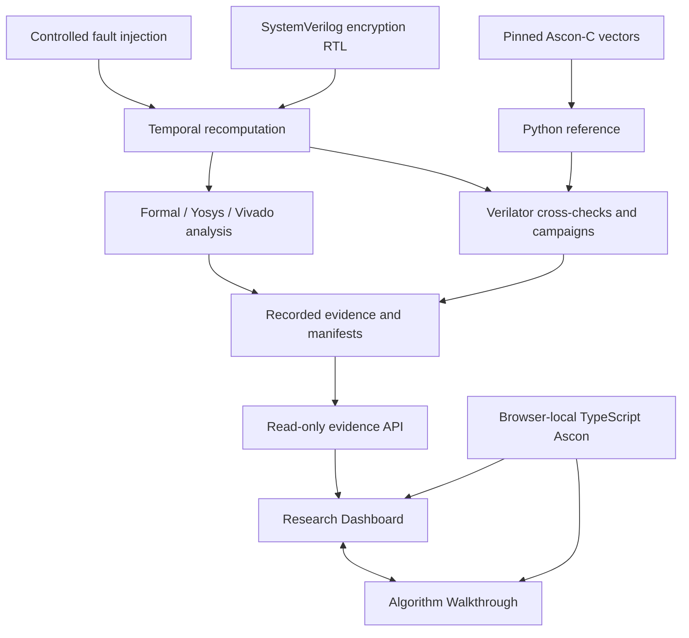

# FaultScope-Ascon

**Pre-Silicon Fault-Injection and Countermeasure Evaluation for NIST Ascon-AEAD128**

FaultScope-Ascon implements Ascon-AEAD128 in Python and synthesizable SystemVerilog, then introduces controlled faults during RTL simulation to evaluate error detection. It studies whether repeating a calculation and comparing its results prevents incorrect encrypted outputs from being released, including when replay, checkpoint or comparison assumptions are deliberately compromised.

## Overview

Hardware faults can alter cryptographic calculations without producing an obvious failure. This workbench connects a software reference, hardware encryption datapath, deterministic fault campaigns and implementation analysis to make those failures observable and reproducible.

The countermeasure uses **temporal recomputation**: save an input state, execute the permutation, replay it using shared hardware, and compare the results. A mismatch raises an alarm and suppresses output validity. The experiments examine both its effectiveness under clean replay and its limitations under more adversarial conditions.

## Key features

| Area | Implementation |
|---|---|
| Cryptography | NIST Ascon-AEAD128 Python encryption/authenticated decryption and five-word, 320-bit permutation |
| Hardware | Synthesizable SystemVerilog p[8]/p[12] and bounded encryption/tag generation |
| Fault detection | Configurable state-bit injection, checkpoint/replay, mismatch alarm and output-valid gating |
| Verification | Official vectors, Python/RTL comparison with Verilator, safety assertions and bounded SAT |
| Implementation analysis | Generic Yosys synthesis, FPGA resource analysis and Vivado placement/routing |
| Research interface | Read-only, evidence-verifying FastAPI API; interactive Research Dashboard |
| Education | Browser-local Algorithm Walkthrough with actual encryption, state traces and authenticated decryption |

## System architecture



The browser performs educational calculations locally; it does not launch Verilator campaigns. The API serves fixed, hash-checked research evidence separately from those calculations.

## Implementation

- **Cryptographic reference:** [Python models](reference) implement standardized little-endian Ascon-AEAD128 and its permutation, checked against the pinned official Ascon-C implementation.
- **Hardware datapath:** [RTL](rtl) implements round processing, permutation control and bounded AEAD encryption/tag generation. A UART wrapper provides framed host commands and status reporting.
- **Temporal protection:** [Protected permutation](rtl/ascon_permutation_temporal.sv) checkpoints the input and reuses the permutation engine for first execution and replay. The [AEAD controller](rtl/ascon_aead_encrypt_temporal.sv) propagates alarms and gates external results.
- **Fault experiments:** [Testbenches](tb) and [runners](experiments) inject selected state-bit faults and compare outcomes with fault-free software results. Research variants also model correlated faults, checkpoint corruption and alarm suppression.
- **Engineering assurance:** [Formal documentation](docs/phase10c_bounded_controller_formal.md) describes controller safety checks, completion witnesses and negative controls. [Vivado documentation](docs/phase12_vivado_implementation.md) records XC7A100T implementation results and internal timing assumptions.
- **Interactive website:** [React/TypeScript components](frontend/src) connect the research presentation to a separate, independently cross-checked browser cryptographic trace engine.

## Experimental results

These are separate deterministic test populations, not estimates of real-world attack probabilities.

| Experiment | Cases | Recorded outcomes |
|---|---:|---|
| Clean replay | 424 | 130 armed requests; 93 applied faults; **93/93 detected**; 331 cases without injection; 0 observed false alarms |
| Adversarial permutation | 240 | 120 raw mismatches; 80 alarms; 60 incorrect permutation-state releases |
| Adversarial bounded AEAD | 600 | 204 raw mismatches; 136 alarms; 102 incorrect ciphertext/tag releases |

An armed request applies a fault only if its selected phase and round are reached; requested injection is therefore different from actual injection. Clean replay assumes a trustworthy replay, checkpoint and comparator. It also recorded zero alarm/valid policy violations.

The adversarial cases deliberately violate those assumptions. Mismatch, alarm and incorrect-release counts overlap and must not be added together. An incorrect release is marked valid but differs from the fault-free output; it does **not** establish receiver-accepted authentication forgery.

Sources: [clean-replay CSV](reports/phase4b_temporal.csv), [permutation CSV](reports/phase7_adversarial.csv), [AEAD CSV](reports/phase7b_aead.csv), and [campaign analysis](reports/phase5/campaign_summary.json). See the [clean-replay](docs/phase4b_temporal_recomputation.md), [adversarial permutation](docs/phase7a_adversarial_temporal.md) and [adversarial AEAD](docs/phase7b_bounded_aead_adversarial.md) methodologies.

## Hardware cost

| Architecture | Historical generic Yosys cells | Mean simulation cycles |
|---|---:|---:|
| Baseline | 8,277 | 47.17 |
| Fault-instrumented | 9,865 | — |
| Temporal-recomputation protected | 12,863 | 95.64 |

Compared with the baseline, protection increased generic cells by approximately **55.41%** and mean simulation cycles by **102.77%**. The cell increase relative to the instrumented variant was 30.39%.

These historical counts use `sv2v` and Yosys `synth -flatten -noabc`; they are not FPGA LUTs or physical silicon area. Simulation cycles are not measured wall-clock latency. See [hardware-cost methodology](docs/phase5_hardware_cost_evaluation.md), the [recorded report](reports/phase5/REPORT.md) and [manifest](reports/phase5/manifest.json). The manifest preserves the original analysis revision `1b7d727136033174c32828f50385a1c7afe7ee1b`, independently of current source HEAD.

Later [Vivado results](docs/phase12_vivado_implementation.md) distinguish synthesis, placement and post-route utilization from those generic counts, with explicit out-of-context clock and external-I/O limitations.

## Interactive website

### Research Dashboard

The dark-themed dashboard presents the project introduction, architecture and temporal-recomputation demonstration alongside recorded experiments, comparisons, hardware measurements and a filterable experiment ledger. Simple and Technical Views share the same verified API data. The Ascon Learning Lab explores permutation mathematics and fault scenarios.

### Algorithm Walkthrough

Enter plaintext, a key, nonce and associated data to run actual browser-local Ascon-AEAD128. An eight-step trace exposes initialization, p[8]/p[12] rounds, padding, byte-level XOR, finalization and tag generation. Playback controls, authenticated software decryption and ciphertext/tag tampering make the calculation explorable. Fault scenarios illustrate permutation-level recomputation rather than a live RTL campaign.

Keys and plaintext are not sent to the research API. Both plaintext and associated data are limited to 16 UTF-8 bytes in the form.

| Page | Local URL |
|---|---|
| Research Dashboard | http://127.0.0.1:5173/#/ |
| Algorithm Walkthrough | http://127.0.0.1:5173/#/walkthrough |
| Dashboard results shortcut | http://127.0.0.1:5173/#/results |

See [walkthrough instructions](docs/algorithm_walkthrough.md) and the [project showcase guide](docs/project_showcase.md).

<a id="start-here-run-the-project"></a>
## Quick start

Requirements: Git, Python **3.12**, [uv](https://docs.astral.sh/uv/), Node.js **22.19+** and npm **10+**. CI uses Python 3.12 and Node 24. Hardware tools are not required just to run the website.

Run these commands in Bash or PowerShell; on Windows, use `npm.cmd` if PowerShell blocks `npm.ps1`:

```text
git clone https://github.com/pm2m1/faultscope-ascon.git
cd faultscope-ascon
uv sync --locked --group dev
npm --prefix frontend ci
```

Start the backend in terminal 1, from the repository root:

```text
uv run uvicorn backend.api:app --host 127.0.0.1 --port 8000
```

Start the frontend in terminal 2, also from the repository root:

```text
npm --prefix frontend run dev
```

Open http://127.0.0.1:5173/#/. Vite proxies API requests to port 8000.

## Reproducible HELLO demonstration

In Algorithm Walkthrough, use these synthetic demonstration inputs; open the advanced inputs to set the key and nonce.

| Field | Value |
|---|---|
| Plaintext | `HELLO` |
| Associated data | `Course: CNS` |
| Key | `000102030405060708090a0b0c0d0e0f` |
| Nonce | `101112131415161718191a1b1c1d1e1f` |
| Expected ciphertext | `a0b29b6679` |
| Expected authentication tag | `38a5911ee12bb09077fdc926a45cae30` |

Click **Encrypt My Message**, explore the trace, then **Verify & decrypt**. Authentication releases `HELLO`; changing ciphertext or tag causes rejection. Fixed demo inputs are not suitable for production: never reuse a nonce with the same real key.

## Testing and verification

The test layers cover official vectors, Python functional behavior, Verilator RTL comparisons, browser traces and interactions, evidence integrity, synthesis checks and bounded controller SAT.

At integrated revision [`7a4fbdd`](https://github.com/pm2m1/faultscope-ascon/commit/7a4fbdd41dcab2a49bcd49145a27bd6002f6444c):

- [Python/RTL, frontend build and synthesis workflow](https://github.com/pm2m1/faultscope-ascon/actions/runs/41343578618) passed: **534 tests passed, 6 skipped, 1 warning**, plus successful production build and synthesis/output-gate checks.
- [Website workflow](https://github.com/pm2m1/faultscope-ascon/actions/runs/41343578511) passed **17 Chromium browser tests**.
- [Bounded controller workflow](https://github.com/pm2m1/faultscope-ascon/actions/runs/41343578503) passed the **18-clock** safety analysis, completion witnesses and negative controls. The permutation child is abstracted; this is not a proof of the entire cryptographic implementation.

These integrated results supersede the historical 514-test Phase 24 count for source testing; they do not replace or repin historical experimental evidence.

For vector/reference tests, first restore the external Ascon-C checkout from the repository root. These commands work in either shell and use the revision pinned in [the reference file](docs/ascon_reference_commit.txt):

```text
git clone https://github.com/ascon/ascon-c.git references/ascon-c
git -C references/ascon-c checkout --detach 446347f21b209f3921c65ece70027c366cbe1693
uv run faultscope-ascon verify-evidence
uv run python -m pytest tests/test_aead.py tests/test_algorithm_walkthrough.py -q
npm --prefix frontend run build
```

The full suite, `uv run python -m pytest tests/ -q`, additionally needs a C/C++ compiler, Verilator, make and CMake; synthesis/formal jobs need Yosys and sv2v. Tests for optional hardware flows have separate opt-in controls. [CI definitions](.github/workflows) specify the tested Linux setup.

For browser tests, set the Python interpreter explicitly so Playwright can start the API using the installed dependencies:

```bash
export FAULTSCOPE_TEST_PYTHON="$(uv run python -c 'import sys; print(sys.executable)')"
(cd frontend && npx playwright install --with-deps chromium)
npm --prefix frontend run test:ui
```

On Windows, install Microsoft Edge and run instead:

```powershell
$env:FAULTSCOPE_TEST_PYTHON = (uv run python -c "import sys; print(sys.executable)").Trim()
npm.cmd --prefix frontend run test:ui
```

Browser logs and screenshots go to unique ignored directories under `build/reproduction/website_ui/`. New experiment outputs should also go under `build/reproduction/`, never overwrite committed campaigns. [Evidence manifests](reports/phase5/manifest.json) preserve historical hashes and tool/source provenance.

## Repository structure

| Directory | Contents |
|---|---|
| [reference/](reference) | Python cryptographic oracle and adversarial models |
| [rtl/](rtl) | Encryption, permutation, protection and UART hardware |
| [tb/](tb) | RTL simulation testbenches and C oracle |
| [experiments/](experiments) | Campaign runners, analysis and formal/synthesis flows |
| [tests/](tests) | Reference, RTL, API, trace and report-validation tests |
| [reports/](reports) | Historical campaign CSVs, summaries and manifests |
| [backend/](backend) | Read-only evidence API |
| [frontend/](frontend) | React/TypeScript website and browser tests |
| [docs/](docs) | Technical methodology, implementation and review documentation |
| [scripts/](scripts) | Reproduction, Vivado and UART tooling |

## Scope and limitations

- Pre-silicon digital simulation and implementation analysis; no demonstrated physical fault injection or verified operating FPGA board.
- RTL supports 0–16 bytes each of plaintext and associated data, encryption and tag generation; authenticated decryption is software-only.
- Clean-replay detection depends on trusted replay/checkpoint/comparison logic. Adversarial incorrect releases do not establish receiver-accepted forgery.
- Formal results cover stated properties and bounds. Routed internal timing does not establish board-level electrical or external-interface signoff.
- The browser implementation is educational, not constant-time or production-certified cryptography. No production cryptographic certification is claimed.

## References and maintainer

- [NIST SP 800-232: Ascon-Based Lightweight Cryptography Standards](https://csrc.nist.gov/pubs/sp/800/232/final).
- [Official Ascon-C implementation at the pinned revision](https://github.com/ascon/ascon-c/tree/446347f21b209f3921c65ece70027c366cbe1693), with its [upstream licensing terms](https://github.com/ascon/ascon-c/blob/446347f21b209f3921c65ece70027c366cbe1693/LICENSE).
- [Hardware-cost methodology](docs/phase5_hardware_cost_evaluation.md), [formal scope](docs/phase10c_bounded_controller_formal.md), [FPGA implementation](docs/phase12_vivado_implementation.md) and [research-release boundary](docs/phase24_research_release.md).

Maintainer: **Parth Mishra — [pm2m1](https://github.com/pm2m1)**.

Ascon and temporal redundancy are established techniques; this project's contribution is their implementation, integration and controlled experimental evaluation. Upstream code retains its applicable license notices. No project-level `LICENSE` is committed; public availability alone does not grant open-source reuse rights.
