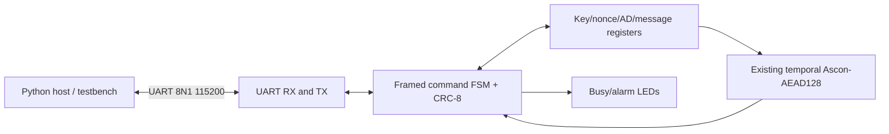

# Phase 11 — UART interface pilot for protected Ascon-AEAD128

## Scope / security warnings

This is a **simulation- and synthesis-targeted laboratory interface** around the **unchanged** `ascon_aead_encrypt_temporal` module. It is *not* a physically verified FPGA implementation, production encryption module, authenticated-decryption interface, or secure serial protocol.

**Keys, nonce, associated data and plaintext traverse UART in the clear.** Neither CRC-8 nor UART provides authentication, confidentiality, replay protection or tamper resistance. Use synthetic test keys only. Do not connect this interface to an untrusted host or use it to encrypt real secrets. A unique nonce is mandatory for each real AEAD encryption using the same key; the demo hardware does not enforce nonce uniqueness. Key registers persist until overwritten or reset. There is no side-channel or physical fault-hardening claim.

The core accepts 0–16 bytes of AD and plaintext; encrypts and produces a 16-byte tag; fault injection is the existing research-only first-pass pre-round bit flip, with a clean replay. The wrapper does not implement decryption, tag verification, or a general message-streaming AEAD engine.

## Hardware structure



Top-level **six one-bit signals**: `clk`, active-low asynchronous `rst_n`, `uart_rx_i`, `uart_tx_o`, `led_busy_o`, `led_alarm_o`. This resolves the original core's 803-bit parallel I/O burden in principle. No XDC pin assignment or board download is included. Reset deassertion synchronization, board-specific USB-UART wiring, electrical standards, board clock constraints and placement/routing must be completed and verified before a bitstream can be called board-ready.

Default `CLOCKS_PER_BIT=868` for a nominal 100 MHz input clock and 115200-baud 8N1 serial. The simulation bench uses `CLOCKS_PER_BIT=8`, **not** a physical baud setup.

## Framing and command table

Request frame: `A5 | CMD | LEN | PAYLOAD (LEN bytes) | CRC8`. CRC-8/ATM polynomial 0x07, initial value 0x00, no reflection/XORout, applied only to `CMD LEN PAYLOAD`.

Response: `5A | STATUS | LEN | PAYLOAD | CRC8` over `STATUS LEN PAYLOAD`. Payload request maximum **16** bytes; response maximum **34** bytes. Byte order for all 128-bit data is byte 0 at the least significant eight bits (`[7:0]`). Commands are *half-duplex*: host must read a full response before sending the next request. The receiver discards bytes during a response. CRC-8 protects against common accidental transmission errors **only**. A badly oversized LEN is rejected immediately; host must wait for the error frame and resynchronize before continuing.

| CMD | Name | Payload | Behavior |
|---|---|---|---|
| `10` | SET_KEY | 16 bytes | Write test key register |
| `11` | SET_NONCE | 16 bytes | Write 128-bit nonce |
| `12` | SET_AD | 16 bytes | Write padded 16-byte AD buffer |
| `13` | SET_MSG | 16 bytes | Write padded 16-byte plaintext buffer |
| `14` | SET_CONTROL | 7 bytes | `[ad_len, msg_len, fault_enable, phase, round, bit_L, bit_H]` |
| `20` | START | 0 bytes | Starts transaction if all five config stages are loaded |
| `21` | READ_RESULT | 0 bytes | Returns result after completion, BUSY if operating |
| `22` | PING | 0 bytes | Returns version `[0x11, 0x00]` |

`SET_CONTROL`: lengths 0–16, fault flag 0/1, phase 0–4, round 0–11, and little-endian bit index 0–319. Invalid controls are rejected. Setting any input invalidates a previously completed response. Busy operations cannot be reconfigured.

Status codes: `00 OK`, `01 BAD_LENGTH`, `02 BAD_CRC`, `03 BUSY`, `04 NOT_READY`, `05 BAD_COMMAND`, `06 BAD_CONTROL`.

Successful READ returns 34 bytes: `[msg_len, flags, ciphertext(16), tag(16)]`; flags bit0=result_valid, bit1=fault_detected, bit2=fault_applied. Ciphertext includes zero padding above `msg_len`. The original core masks both output vectors to zero on detected faults; the host parser rejects nonzero data when `result_valid` is false. A fault alarm is **not** the same as receiver-side authenticated-decryption rejection.

## Local simulation and XC7 mapping

From project root on a Mac with Verilator, Yosys, and sv2v 0.0.13:

```bash
uv run python -m pytest tests/test_phase11_uart.py tests/test_phase11_fpga.py -v
FAULTSCOPE_RUN_PHASE11_UART=1 uv run python -m pytest tests/test_phase11_uart.py -v
uv run python -m experiments.phase11_fpga --out-dir build/reproduction/phase11
uv run python -m pytest tests/ -q
```

The **live** testbench sends serial request bits, verifies CRC/length rejection, encrypts empty AD and plaintext against a pinned independent Ascon-Python expected tag, then injects a single first-pass state bit flip to check fault alarm, no valid output, and all-zero data. This is not a security/throughput guarantee and does not demonstrate robustness against the Phase 7 attacks. RTL compilation and all behavior checks must actually pass before committing.

The optional FPGA mapping uses `synth_xilinx -family xc7 -flatten -noiopad -noclkbuf` and validates all six one-bit top-level signals. Its LUT/FF results are **out-of-context mapped-resource counts**, not placed/routed board utilization, throughput, timing closure, power or physically observed fault resistance. It checks the historical 7 RTL SHA-256 digests before mapping. All outputs remain in ignored `build/reproduction/phase11/`.

Manual GitHub verification: `gh workflow run phase11-uart.yml --ref main`, only **after Mac simulation and mapping pass**. The GitHub workflow re-runs the UART test and XC7 mapping and archives artifacts for 14 days. Differences between Yosys 0.69 Mac and Ubuntu's older Yosys are expected.

## Optional Python host (only for a verified board design)

The `scripts/phase11_uart_host.py` module can construct and decode frames without dependencies. For a connected FPGA, install `pyserial` separately, **use nonsecret test vectors only**, and use the CLI with optional `pyserial` installed ephemerally (example uses the synthetic vector from the testbench):

```bash
uv run --with pyserial python -m scripts.phase11_uart_host --port /dev/ttyUSB0 \
  --key 000102030405060708090a0b0c0d0e0f \
  --nonce 101112131415161718191a1b1c1d1e1f \
  --ad '' --msg ''
```

The UART transport must already be pinned to the right USB-UART interface; **no existing FPGA bitstream or Nexys master XDC is included**. Do not expect this command to function with a naked XC7A100T without the board integration/clock/reset/constraints.

## Acceptance gates and future board bring-up

1. Python frame and parsing tests pass.
2. Verilator end-to-end test passes (including known AEAD result and fault rejection).
3. XC7 mapping of the complete UART wrapper passes and yields **six scalar top-level signals**.
4. GitHub manual pilot runs on Ubuntu and passes both simulation and synthesis.
5. Later: select the correct Nexys board revision, validate master XDC and on-board USB-UART labels, synchronize reset release, implement Vivado clock and pin constraints, run DRC and full timing analysis, load a bitstream and compare real UART captures against known answer vectors. This final step is **not covered** by Phase 11.

### Limitations to preserve in CNS report

No physical faults, authenticated decryption, secure UART key transfer, key erasure protocol, nonce replay protection, power, place-and-route, or board test are demonstrated. CRC-8 is not a MAC. The serial host overhead dominates short 0–16-byte transactions; do not compare its elapsed time directly with the core's 47/96-cycle figures without separating UART transfer time.
